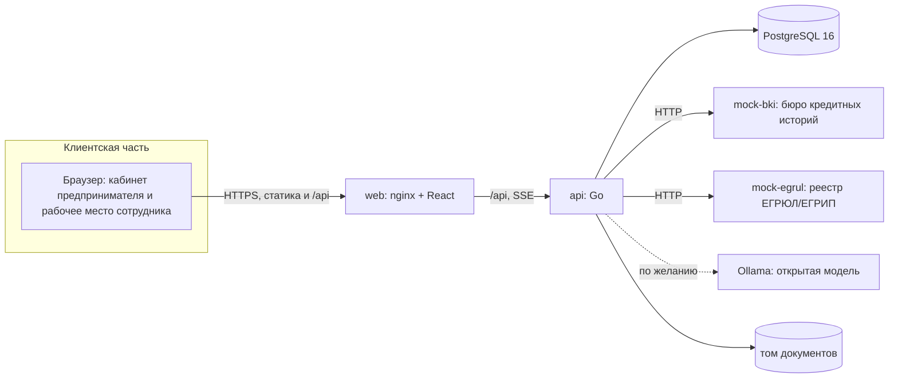

# Архитектура

«Матрица» состоит из веб-приложения, одного API на Go, базы данных и двух смоделированных внешних источников. Все компоненты запускаются одной командой `docker compose up --build`.

## Состав

| Компонент | Назначение | Технологии |
|---|---|---|
| `web` | Лендинг, вход, кабинет клиента, рабочее место сотрудника, Swagger UI на `/docs` | React 19, TypeScript, Vite, Tailwind 4, nginx |
| `api` | Заявки, машина состояний, конвейер обработки, скоринг, решение, события в реальном времени | Go 1.26, chi, pgx, sqlc, goose |
| `mock-bki` | Смоделированное бюро кредитных историй: балл, активные кредиты, долг, максимальная просрочка | Go |
| `mock-egrul` | Смоделированный реестр: статус компании, ОКВЭД, дата регистрации, признаки банкротства | Go |
| `postgres` | Заявки, журнал переходов, оценки, предложения, уведомления, пользователи | PostgreSQL 16 |
| `ollama` | По желанию: открытая модель для подсказки продукта и пояснения решения | Ollama |

## Устройство API

Пакеты в `internal/`:

| Пакет | Ответственность |
|---|---|
| `workflow` | Состояния заявки, допустимые переходы, события. Единственное место, где определено, из какого состояния куда можно перейти |
| `pipeline` | Этапы обработки: приём, проверка полноты, обогащение данными, оценка, решение. Каждый этап переводит заявку по машине состояний |
| `integrations` | Клиенты бюро и реестра: таймауты, повторы, обработка сбоев |
| `scoring` | Расчёт баллов, класса, вероятности дефолта, ожидаемых потерь, доступности платежа. Чистые функции без обращения к базе |
| `decision` | Решение по результату оценки: автоотказ, предложение, передача сотруднику, встречные условия |
| `products` | Каталог продуктов: лимиты, документы, базовые ставки, доля потерь при дефолте |
| `httpapi` | HTTP-слой по контракту `api/openapi.yaml`: авторизация, роли, валидация |
| `events` | Рассылка изменений клиентам по SSE |
| `ai` | Подсказка продукта и пояснение решения; запасной режим на правилах |
| `store` | Запросы к базе (sqlc) |
| `seed` | Синтетические компании, пользователи и история |
| `mocks` | Реализация смоделированных источников |

Контракт API (`api/openapi.yaml`) — источник истины. Из него генерируются модели для Go и типы для TypeScript, а контрактные тесты проверяют ответы сервера на соответствие описанию.

## Жизненный цикл заявки

Диаграмма состояний и таблица переходов — в [state-diagram.md](state-diagram.md). Главное:

1. Клиент отправляет заявку; повторная отправка с тем же `Idempotency-Key` не создаёт дубль.
2. Конвейер проверяет полноту, запрашивает бюро и реестр, считает оценку и принимает решение или передаёт сотруднику.
3. Каждый переход пишется в журнал (`application_events`) с автором, временем, причиной и данными.
4. Изменения доходят до открытых страниц клиента и сотрудника через SSE без перезагрузки.

## Данные и расчёты

Схема базы описана в [data-model.md](data-model.md). Формулы оценки риска — в [scoring.md](scoring.md), процессные решения — в [product.md](product.md).

## Безопасность

- Вход по логину и паролю, пароли хранятся как bcrypt-хэши, сессия — JWT с ограниченным сроком.
- Роли `client` и `staff` разделены на уровне API: клиент видит только свои заявки, сотрудник — рабочее место; обращение не по роли возвращает отказ.
- Ограничение числа неудачных попыток входа: считается по паре «адрес + логин», чтобы подбор пароля блокировал только подбирающего.
- Регистрация клиентов: проверка формы, согласие на обработку данных, один аккаунт на компанию, ограничение числа регистраций с одного адреса. Роль всегда «клиент»: сотрудников через форму завести нельзя.
- Заголовки безопасности и политика содержимого (CSP) настроены в nginx.
- Загрузка документов проверяется по типу и размеру; файлы лежат вне веб-корня.
- Секреты задаются переменными окружения; в режиме `APP_ENV=prod` запуск без `JWT_SECRET` невозможен.
- Ответы с ошибками не раскрывают внутреннее устройство.

## Надёжность

- **Сбой внешнего источника.** Запросы к бюро и реестру идут с таймаутом и повторами. Если источник недоступен, заявка остаётся на этапе сверки данных, клиент видит понятный статус; после исчерпания попыток заявка уходит сотруднику с пометкой «нужна ручная проверка». Сбой можно воспроизвести: `POST :8081/mock/fail?on=true`.
- **Идемпотентность.** Повторная отправка заявки безопасна.
- **Конкурентное изменение.** У заявки есть версия; действие по устаревшей версии отклоняется, и два сотрудника не перезапишут решение друг друга.
- **Резервный режим ИИ.** Любой сбой модели переключает на правила, процесс не блокируется.
- **Состояние сервисов.** Конечные точки `/healthz` и `/readyz`; в Docker Compose заданы проверки состояния и порядок запуска.

## Масштабирование и эксплуатация

- API не хранит сессии в памяти: JWT позволяет запускать несколько экземпляров за балансировщиком.
- Версии языков и библиотек зафиксированы: `go.mod`/`go.sum`, `package-lock.json`, теги образов Docker без `latest`.
- Миграции применяются автоматически при старте (goose).

## Ограничения и развитие

| Ограничение | Следствие | Следующий шаг |
|---|---|---|
| События SSE рассылаются из памяти одного экземпляра API | При нескольких экземплярах клиент может не получить событие от другого экземпляра | Брокер сообщений или `LISTEN/NOTIFY` в PostgreSQL |
| Документы лежат в локальном томе | Не подходит для нескольких узлов | Объектное хранилище |
| Параметры оценки не откалиброваны | Баллы, PD и LGD иллюстративные | Калибровка на данных банка, валидация модели |
| Подписание и выдача смоделированы | Нет реальных операций | Интеграция с платёжным и подписывающим сервисами |
| Одна роль сотрудника | Нет разграничения полномочий по суммам | Лимиты полномочий и кредитный комитет |
| Нет роли администратора правил | Параметры меняются в конфигурации | Интерфейс управления правилами с журналом изменений |
