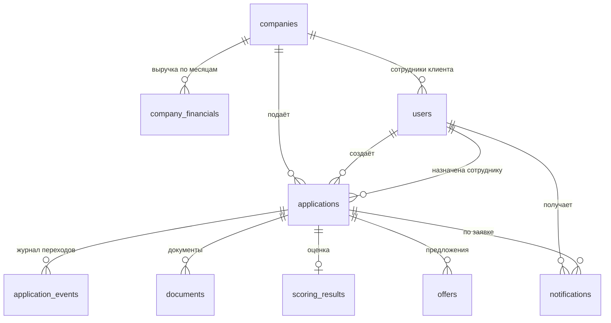

# Модель данных

База — PostgreSQL 16. Схема создаётся миграциями goose из каталога `migrations/` при старте API. Суммы хранятся в копейках (`bigint`), время — `timestamptz`.



## Таблицы

### companies — компании клиентов (синтетические)
| Поле | Тип | Смысл |
|---|---|---|
| id | uuid | Идентификатор |
| inn | text, уникальный | ИНН |
| name | text | Название |
| kind | `ooo` или `ip` | Форма |
| registered_at | date | Дата регистрации |
| okved, okved_group | text, int 1–3 | Вид деятельности и группа риска отрасли |
| director | text | Руководитель |
| address | text | Адрес |
| monthly_obligations | bigint | Действующие ежемесячные платежи |

### company_financials — выручка по месяцам
Ключ (`company_id`, `month`), поле `revenue`. По этим данным считаются средняя выручка и её стабильность.

### users — пользователи
`login` уникальный, `password_hash` (bcrypt), `role` (`client`, `staff` — аналитик или `support` — специалист поддержки), `company_id` (у сотрудников пусто), `full_name`, `consented_at` (когда человек при регистрации согласился на обработку данных; у демо-аккаунтов пусто, миграция 0003).

### chat_threads, chat_messages — чат с помощником и сотрудником (миграция 0004)
Один разговор на клиента: `chat_threads.user_id` уникален. `status` — `bot`, `waiting` или `live`, `agent_id` — подключённый специалист, `requested_at` — когда клиент попросил сотрудника. Сообщения в `chat_messages`: `author` (`client`, `assistant`, `agent`, `system`), `text`, `source` (`ai` или `rules`, только у помощника), `off_topic`, `agent_name`. Подробнее: [ai-chat.md](ai-chat.md).

### applications — заявки
| Поле | Смысл |
|---|---|
| company_id, user_id | Чья заявка |
| product_id | Продукт: `working_capital`, `equipment`, `overdraft`, `express` |
| amount, term_months, purpose | Параметры запроса |
| status | Состояние по машине состояний ([state-diagram.md](state-diagram.md)) |
| data | Дополнительные данные заявки (jsonb) |
| version | Версия для оптимистической блокировки |
| idempotency_key | Защита от повторной отправки; уникален в паре с пользователем |
| assigned_to | Сотрудник, взявший заявку в работу |
| created_at, updated_at | Время |

Индексы: по пользователю и дате, по статусу и времени обновления, уникальный по паре (`user_id`, `idempotency_key`).

### application_events — журнал переходов
Неизменяемая история: `at`, `actor` (клиент, сотрудник или система), `event`, `from_status`, `to_status`, `comment`, `payload`. По нему восстанавливается, кто и на каком основании менял заявку.

### documents — документы заявки
`kind`, `filename`, `content_type`, `size`, `path` (в томе), `uploaded_at`.

### scoring_results — результат оценки (одна запись на заявку)
| Поле | Смысл |
|---|---|
| score, grade | Итоговый балл и класс A–D |
| factors | Баллы по факторам с пояснениями (jsonb) |
| hard_stops | Сработавшие жёсткие стопы (jsonb) |
| max_affordable, debt_load | Предельная сумма и нагрузка на выручку |
| enrichment | Ответы бюро и реестра, на которых построена оценка (jsonb) |
| metrics | PD, LGD, EAD, ожидаемые потери, надбавка к ставке, платёж (jsonb, миграция 0002) |

### offers — предложения клиенту
`amount`, `term_months`, `rate_bp` (ставка в базисных пунктах), `monthly_payment`, `source` (автоматически или сотрудник), `active`, `expires_at` (7 дней), `created_at`.

### notifications — уведомления внутри кабинета
`user_id`, `application_id`, `text`, `read_at`, `created_at`.

## Целостность и защита данных

- Внешние ключи с каскадным удалением для зависимых записей заявки.
- Проверки значений (`CHECK`) для формы компании, группы отрасли и роли пользователя.
- Версия заявки защищает от одновременных изменений.
- Пароли хранятся только как хэши. Все данные в базе синтетические.

## Как смотреть данные

```bash
docker compose exec postgres psql -U matritsa -d matritsa
```

Примеры запросов:

```sql
-- заявки с классом риска и ожидаемыми потерями
SELECT a.id, a.status, s.grade, s.metrics->>'expectedLoss' AS el
FROM applications a LEFT JOIN scoring_results s ON s.application_id = a.id
ORDER BY a.created_at DESC;

-- путь одной заявки
SELECT at, actor, event, from_status, to_status FROM application_events
WHERE application_id = '<id>' ORDER BY id;
```
