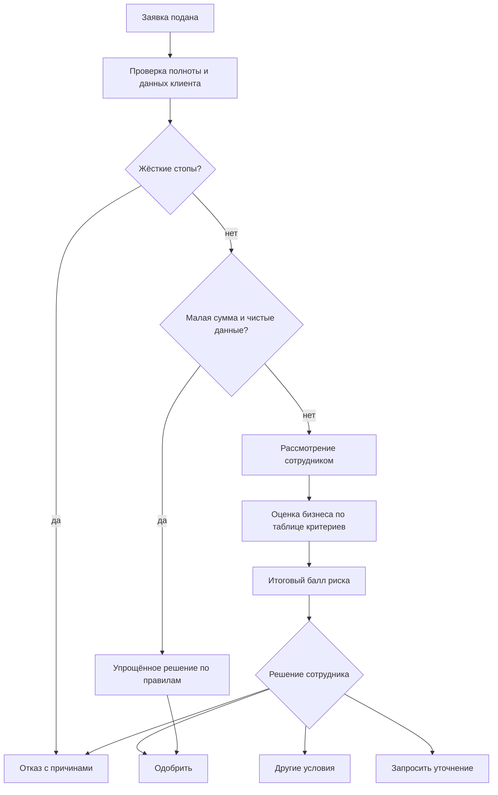

# Продукт: как устроен кредитный процесс и почему

Документ описывает, для кого сделана «Матрица», какой процесс она ведёт и где проходит граница между автоматикой и человеком. Исследование процесса предшествует экранам: сначала потребности и границы, затем состав функций.

## Для кого и зачем

**Предприниматель** (ИП или небольшая компания). Хочет понять, какой кредит ему подходит, подать заявку без визита в отделение, знать, на каком этапе она находится, и получить решение с понятными причинами. Если банк предлагает другие условия, нужно видеть, что именно изменилось и почему.

**Сотрудник банка** (кредитный аналитик). Хочет видеть заявку целиком: данные клиента, результаты проверок, документы, расчёт платежа. Ему нужно оценить бизнес по единой таблице критериев, получить итоговый балл и принять решение, которое можно объяснить клиенту и проверить позже.

**Банк.** Нужна управляемость риска (решение не зависит от настроения), скорость на простых заявках, внимание людей на сложных, прозрачный журнал: кто, когда и на каком основании решил.

## Что мы выяснили о практике

| Наблюдение | Что из этого следует для продукта |
|---|---|
| Банки применяют два режима: быстрое решение по скорингу для малых сумм и полноценный андеррайтинг с участием аналитика для остальных | В продукте два режима с чёткой границей |
| Автоматическая оценка не замечает подозрительного поведения и особых случаев; экспертное мнение остаётся частью решения | Сотрудник оценивает бизнес сам по таблице критериев, итоговый балл за ним |
| Банк обязан сформировать профессиональное суждение о финансовом положении заёмщика | Итоговое решение по стандартным заявкам принимает человек, и это фиксируется в журнале |
| Помимо долговой нагрузки банки смотрят покрытие платежей денежным потоком (DSCR) | Доступность платежа считается явно и показывается сотруднику |
| Условия различаются по продуктам: обеспечение, срок, цель | У каждого продукта свои лимиты, документы и доля потерь при дефолте |

Источники и оговорки: данные открытые, часть материалов справочные, точные внутренние пороги банков публично не раскрываются. Параметры модели в продукте задаются в конфигурации и подлежат калибровке на данных банка.

## Три режима рассмотрения

| Режим | Когда включается | Кто решает | Что видит клиент |
|---|---|---|---|
| Упрощённый | Класс A, сумма в пределах лимита продукта и платёжеспособности, ранее погашено не менее 50 % запрошенной суммы | Правила | Предложение сразу, с расчётом платежа |
| Стандартный | Всё остальное | Сотрудник по таблице критериев | Статус «на рассмотрении у сотрудника банка», затем предложение, встречные условия или отказ |
| Автоотказ | Компания не действует, признаки банкротства, просрочка более 90 дней, нет подтверждённой выручки | Правило | Отказ с понятными причинами |

Принцип: система ускоряет простое и защищает от очевидного, но не заменяет оценку бизнеса человеком там, где она нужна.

## Таблица критериев сотрудника

Оценка складывается из двух частей.

**Считает система** по данным реестра, бюро, отчётности и документов: покрытие долга денежным потоком (DSCR), Долг / EBITDA, рентабельность и стабильность выручки, ликвидность, просрочки за 36 месяцев, действующие обязательства, возраст бизнеса, отрасль. Это цифры, которые сотрудник получает готовыми и не вводит повторно.

**Требует суждения человека**. В боевой версии это оценивает сотрудник. В прототипе по этим критериям система даёт оценку по смоделированным данным и документам, а сотрудник её проверяет:

| Критерий | Что оценивает человек |
|---|---|
| Обоснованность цели и суммы | Соответствие цели документам: счёту, договору, смыслу покупки |
| Репутация руководителя и бизнеса | Контекст и публичные сведения, опыт |
| Аномалии в выписке | Круговые переводы, внезапные скачки оборотов, подозрительные контрагенты |
| Подлинность и полнота документов | Файлы настоящие и соответствуют заявке |
| Обеспечение и особые условия | Поручительство, залог, оговорки |

В прототипе все эти критерии входят в расчёт баллов автоматически (аномалии в выписке, репутация, обеспечение и цель с суммой по смоделированным данным и документам заявки), сотрудник видит баллы с пояснением и принимает решение. Ручная правка баллов сотрудником и проверка подлинности документов в прототип не вошли. Итоговый балл превращается в класс риска A–D, от класса зависят вероятность дефолта и ожидаемые потери. Формулы описаны в [scoring.md](scoring.md).

## Продукты

| Продукт | Для чего | Обеспечение | Доля потерь при дефолте |
|---|---|---|---|
| Оборотные средства | Текущие расходы, закупки, сезонность | Без залога | 60 % |
| Оборудование | Покупка техники и оборудования | Приобретаемый актив | 40 % |
| Овердрафт | Кассовые разрывы | Без залога | 65 % |
| Экспресс-кредит | Малая сумма, быстрое решение | Без залога | 75 % |

### За пределами версии и план развития

Мы знаем, какие продукты банки предлагают малому бизнесу помимо четырёх выше, и сознательно их не включили: каждый добавляет отдельный блок проверок, которого кейс не требует.

| Направление | Что это | Почему не в этой версии | Как добавить |
|---|---|---|---|
| Кредитная линия | Возобновляемый лимит, деньги берутся траншами | Нужен учёт траншей и остатка лимита | Ближайший шаг: основа есть в овердрафте |
| Лизинг | Оборудование принадлежит лизингодателю, клиент платит частями | Другая правовая модель, не кредит | Отдельный продукт со своим процессом |
| Кредиты с залогом недвижимости | Обеспечение, которое банк оценивает | Оценка стоимости и юридическая проверка залога | Дополнительный этап в конвейере |
| Поручительство третьих лиц | Другой человек отвечает по кредиту | Проверка поручителя | Дополнительные участники заявки |

## Границы продукта

**Внутри.** Вход, выбор продукта, заявка с документами, автоматические проверки, расчёт платежа, оценка, решение, встречные условия, подписание и выдача, лента предложений, уведомления внутри кабинета, рабочее место сотрудника с очередью и журналом.

**Снаружи.** Реальные БКИ, ФНС, платёжные и подписывающие системы заменены смоделированными источниками, данные синтетические. Уведомления по электронной почте, SMS и в мессенджерах не предусмотрены: весь путь проходит внутри кабинета.

### Лента предложений вместо новостной ленты

В тексте кейса среди рекомендаций для показа есть новостная лента, которая меняется под клиента. К кредитному кабинету такое требование не относится: у предпринимателя, который оформляет кредит, нет новостей банка, за которыми он пришёл. Мы не стали ни пропускать пункт, ни добавлять ленту ради ленты, а переосмыслили его под свою задачу:

- **Лента предложений «Для вашего бизнеса»** на главной кабинета. Карточки зависят от компании и поданных заявок и подсказывают следующий шаг: продукт под отрасль, уточнение, подпись, что делать после отказа.
- **Уведомления** (колокольчик). Каждый шаг процесса оставляет запись, и клиент видит движение заявки, не заходя на её страницу.

Карточки ленты собираются правилами (`internal/feed`) из профиля компании (отрасль по ОКВЭД) и статусов её заявок: тексты шаблонные, но набор карточек и их порядок зависят от данных клиента. Уведомления создаёт сам конвейер при переходах заявки.

## Сроки и статусы

Клиент всегда видит, где его заявка: заявка, проверка, оценка, решение, деньги. Предложение действует 7 дней. Сотрудник может запросить уточнение: тогда заявка ждёт ответа клиента, и сроки рассмотрения не идут.

## Как измерять качество

| Показатель | Зачем |
|---|---|
| Доля заявок, решённых без участия сотрудника | Скорость на простом потоке |
| Время от подачи до решения по режимам | Сравнение упрощённого и стандартного |
| Доля возвратов на уточнение | Качество формы и подсказок |
| Расхождение между баллом системы и итоговым баллом сотрудника | Где система ошибается; основа для пересчёта параметров |

Первые четыре показателя и число заявок, ждущих сотрудника, считаются по журналу заявок и видны аналитику на странице «Показатели» (`GET /api/v1/staff/metrics`). Расхождение баллов появится, когда сотрудник сможет править баллы.
| Доля принятых предложений | Привлекательность условий |

## Решения, которые нужно подтвердить команде

1. Порог суммы упрощённого режима по каждому продукту.
2. Итоговый список экспертных критериев сотрудника и их вес.
3. Нужно ли показывать клиенту итоговый класс риска или только решение и причины.
4. ~~Заменить порог нагрузки 30 % выручки на DSCR или оставить оба показателя.~~ Решено: учитываются оба показателя (долговая нагрузка и DSCR), они отвечают на разные вопросы.
